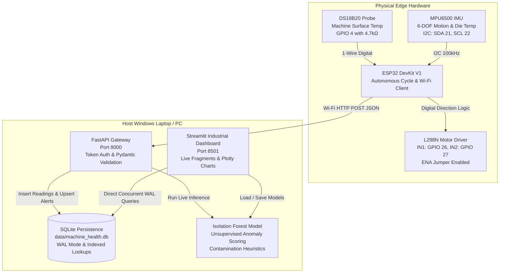

# AI Machine Health Monitor — Complete Client Installation, Operation & Engineering Manual

> **System Title:** AI-Based Machine Health Monitoring and Anomaly Detection Using Machine Learning  
> **Target Audience:** System Operators, Commissioning Engineers, Lab Technicians, and Evaluators  
> **Host Operating System:** Microsoft Windows 10 / Windows 11 (64-bit)  
> **Document Status:** Complete Installation & Field Verification Manual (Release 1.0.0)

---

## Table of Contents

- [Chapter 1: Project Introduction](#chapter-1-project-introduction)
- [Chapter 2: Complete Prerequisites](#chapter-2-complete-prerequisites)
- [Chapter 3: Download and Extract the Project](#chapter-3-download-and-extract-the-project)
- [Chapter 4: Install Python and Dependencies](#chapter-4-install-python-and-dependencies)
- [Chapter 5: Environment Configuration](#chapter-5-environment-configuration)
- [Chapter 6: Install Arduino IDE and ESP32 Firmware](#chapter-6-install-arduino-ide-and-esp32-firmware)
- [Chapter 7: Complete Hardware Wiring & Circuit Specifications](#chapter-7-complete-hardware-wiring--circuit-specifications)
- [Chapter 8: Database Setup, Schema & Verification](#chapter-8-database-setup-schema--verification)
- [Chapter 9: Run the Full Application](#chapter-9-run-the-full-application)
- [Chapter 10: First-Run Verification Checklist](#chapter-10-first-run-verification-checklist)
- [Chapter 11: Troubleshooting Guide](#chapter-11-troubleshooting-guide)
- [Chapter 12: Client Handover & Daily Operation](#chapter-12-client-handover--daily-operation)
- [Chapter 13: Client Convenience Scripts](#chapter-13-client-convenience-scripts)
- [Chapter 14: Security, Safety & Engineering Limitations](#chapter-14-security-safety--engineering-limitations)

---

## Chapter 1: Project Introduction

### 1.1 What the System Does
The **AI Machine Health Monitor** is a hybrid IoT edge telemetry and predictive maintenance platform designed to inspect mechanical rotating machinery (such as motors, pumps, and gearboxes), detect anomalous states, calculate indicative machine health scores, and trigger operator warnings before sudden catastrophic failure occurs.

The system unifies:
1. **Physical Hardware Telemetry:** An ESP32 DevKit V1 microcontroller equipped with an MPU6500 6-DOF IMU (motion, acceleration, rotation, and chip temperature), a DS18B20 digital waterproof probe (machine casing temperature), and an L298N dual H-bridge motor driver driving a rotating DC motor test load.
2. **High-Performance Ingestion Gateway:** A FastAPI asynchronous REST server (`http://<PC_LAN_IP>:8000/api/readings`) receiving HTTP POST JSON payloads with device token authentication.
3. **Persistent Relational Database:** SQLite database (`data/machine_health.db`) configured with Write-Ahead Logging (WAL mode), high-concurrency connections, indexed lookups, and automated alert lifecycle management.
4. **Machine Learning Anomaly Engine:** Unsupervised Scikit-learn **Isolation Forest** tree ensembles fitted on multi-variable baseline sensor telemetry to detect multidimensional degradation patterns.
5. **Interactive Industrial Web Dashboard:** Multi-page Streamlit portal (`http://localhost:8501`) utilizing real-time `@st.fragment` background refreshes (1–2 seconds) for gap-free live streaming charts, heuristic condition deductions, alert workflows, and report exports.

### 1.2 System Architecture Diagram



### 1.3 Software-Only vs. Real Hardware Operation

| Feature | Software Demonstration Mode | Real Hardware IoT Mode |
| :--- | :--- | :--- |
| **Microcontroller / Sensors** | Not required. Uses pre-packaged datasets (`sample_esp32_hardware_run.csv`, NASA C-MAPSS) or custom CSV uploads. | Requires physical ESP32, MPU6500, DS18B20, 4.7kΩ pull-up, L298N, DC motor, and external power supply. |
| **FastAPI Backend (Port 8000)** | Optional (only required if simulating live network streams). | **Mandatory.** Must run continuously to receive Wi-Fi HTTP POST telemetry from ESP32. |
| **Streamlit Dashboard (Port 8501)** | **Mandatory.** Displays analytics, dataset exploration, training, and reports. | **Mandatory.** Displays live 1–2s fragment streaming, live hardware heartbeat, and active alerts. |
| **Machine Learning Pipeline** | Full Isolation Forest training, contamination tuning, model saving, and confusion metrics. | Real-time live inference on incoming sensor packets using saved model artifacts. |
| **Motor State** | Displays hardware architecture specifications. | Microcontroller autonomously cycles motor (Forward 2s → Stop 2s → Reverse 2s → Stop 2s); correlated with vibration telemetry. |

---

## Chapter 2: Complete Prerequisites

Verify and install the following software packages before running the application:

### 2.1 Hardware Requirements
- **Host Laptop/PC:** Any Windows 10 or 11 laptop/desktop with at least 4 GB RAM (8 GB recommended), a free USB port, and an active Wi-Fi interface.
- **Microcontroller:** ESP32 DevKit V1 (30-pin or 36-pin module).
- **USB Cable:** Micro-USB **Data Cable** (verify it is not a charge-only cable).
- **Sensors:**
  - 1× MPU6500 or MPU6050 6-DOF IMU breakout board.
  - 1× DS18B20 stainless-steel probe (waterproof digital temperature sensor).
  - 1× 4.7 kΩ carbon or metal film pull-up resistor.
- **Motor Subsystem:**
  - 1× L298N Dual H-Bridge motor driver module.
  - 1× 3V–6V DC toy/hobby motor.
  - 1× External DC power source (4× AA battery pack or 5V–12V DC bench power supply).
  - Breadboard and female-to-male/female-to-female jumper wires.
- **Wi-Fi Network:** Standard **2.4 GHz Wi-Fi** network (ESP32 hardware does not support 5 GHz Wi-Fi).

### 2.2 Host Software & Tested Versions
- **Operating System:** Windows 10 / Windows 11 (64-bit).
- **Python:** **Python 3.10.x to 3.13.x** (64-bit). *(Tested on Python 3.13.5)*.
- **Git:** Git for Windows (v2.40+), optional if extracting from ZIP.
- **Arduino IDE:** **Arduino IDE 2.3.x** or higher.
- **ESP32 Board Package:** `esp32` by **Espressif Systems** (v2.0.11 or v3.0+).
- **USB-to-UART Driver:** Silicon Labs CP210x or WCH CH340 driver (depending on your ESP32 board's USB interface chip).

### 2.3 How to Check Installed Software
Open PowerShell on your Windows laptop:

```powershell
# 1. Verify Python
py --version
# Expected: Python 3.10.x - 3.13.x (If 'py' is not found, test 'python --version')

# 2. Verify pip package manager
py -m pip --version
# Expected: pip 24.x or higher

# 3. Verify Git (Optional)
git --version
```

If Python is missing:
1. Download Python from official website: https://www.python.org/downloads/
2. **CRITICAL:** In the installer, check the box: `[x] Add python.exe to PATH`.
3. Select "Customize installation" and ensure `pip` and `py launcher` are checked.

---

## Chapter 3: Download and Extract the Project

### 3.1 Folder Structure Verification
Place the project folder at a local path without special characters or spaces. For example:
`C:\Users\Pratik\Downloads\MachineHealth`

Open PowerShell and navigate to the project directory:

```powershell
cd C:\Users\Pratik\Downloads\MachineHealth
```

Verify that the following directory structure is present:

```powershell
Get-ChildItem -Name
```

Expected directory tree:
```
MachineHealth/
├── api/
│   ├── __init__.py
│   ├── main.py              # FastAPI Telemetry Gateway
│   └── schemas.py           # Pydantic request/response schemas
├── dashboard/
│   ├── __init__.py
│   ├── styles.py            # Industrial dark navy CSS tokens
│   ├── components/
│   │   ├── cards.py         # KPI cards, header banners, motor status
│   │   ├── charts.py        # Gap-break Plotly visualization builders
│   │   └── sidebar.py       # Sidebar navigation and live heartbeat
│   └── pages/
│       ├── p1_overview.py           # Real-time overview dashboard
│       ├── p2_live_monitoring.py    # High-frequency streaming monitor
│       ├── p3_ai_anomaly.py         # Isolation Forest training & evaluation
│       ├── p4_sensor_analytics.py   # Statistical diagnostics & correlations
│       ├── p5_dataset_analysis.py   # CSV upload, inspection & cleaning
│       ├── p6_alert_history.py      # Deduplicated alert audit log
│       ├── p7_reports_export.py     # Analytical summaries & CSV export
│       ├── p8_model_info.py         # Registered models & architecture
│       ├── p9_hardware_status.py    # Pinouts, diagnostics & wiring schematics
│       └── p10_about.py             # System architecture & project guide
├── data/
│   ├── machine_health.db    # SQLite database (persisted telemetry & alerts)
│   ├── raw/                 # Pre-packaged baseline and NASA datasets
│   └── processed/           # Sanitized datasets
├── firmware/
│   ├── README.md
│   ├── esp32_wifi_monitor/  # Primary Wi-Fi HTTP POST telemetry sketch
│   │   └── esp32_wifi_monitor.ino
│   └── sensor_test/         # Standalone hardware diagnostic sketch
│       └── sensor_test.ino
├── models/                  # Serialized Isolation Forest model artifacts (.joblib)
├── reports/                 # Generated analytical reports
├── scripts/
│   ├── setup_windows.ps1    # Automated one-click installer
│   ├── start_system.ps1     # Dual-window system launcher
│   └── stop_system.ps1      # Safe port-specific shutdown
├── src/
│   ├── alerts.py            # Threshold evaluation & machine health status
│   ├── anomaly_detection.py # Isolation Forest machine learning engine
│   ├── config.py            # Environment configuration & settings
│   ├── data_cleaning.py     # Pandas data cleaning & imputation
│   ├── data_loader.py       # CSV dataset ingestion
│   ├── database.py          # SQLite persistence & WAL management
│   ├── feature_engineering.py# ML feature preparation
│   ├── live_monitor.py      # Real-time buffer manager & heartbeats
│   ├── reporting.py         # Markdown summary report generator
│   └── validation.py        # Telemetry range sanitization
├── tests/                   # Complete Pytest automated verification suite
├── .env.example             # Template environment configuration
├── app.py                   # Streamlit web entry point
├── GUIDE.md                 # Complete Client Installation & Operating Manual
├── README.md                # Project architecture summary
└── requirements.txt         # Tested Python dependency manifest
```

---

## Chapter 4: Install Python and Dependencies

Follow these exact steps to create an isolated Python virtual environment:

### Step 1: Open PowerShell in Project Root
```powershell
cd C:\Users\Pratik\Downloads\MachineHealth
```

### Step 2: Configure PowerShell Script Execution Policy
Windows restricts script execution by default. Allow local virtual environment activation scripts:
```powershell
Set-ExecutionPolicy -ExecutionPolicy RemoteSigned -Scope CurrentUser
```
*(If prompted, type `Y` and press Enter).*

### Step 3: Create the Virtual Environment
```powershell
py -m venv .venv
```
*(If `py` is not recognized, use `python -m venv .venv`).*

### Step 4: Activate the Virtual Environment
```powershell
.\.venv\Scripts\Activate.ps1
```
Upon successful activation, your PowerShell prompt will display `(.venv)` at the beginning:
```powershell
(.venv) PS C:\Users\Pratik\Downloads\MachineHealth>
```

### Step 5: Upgrade pip
```powershell
python -m pip install --upgrade pip
```

### Step 6: Install Project Dependencies
```powershell
pip install -r requirements.txt
```

### Step 7: Verify Installation
Run the complete test suite to confirm all libraries are properly installed and functional:
```powershell
pytest -v
```
**Expected Result:**
```
============================= 29 passed in 5.61s =============================
```

---

## Chapter 5: Environment Configuration

The application reads configuration settings from a local `.env` file with secure defaults.

### 5.1 Initialize `.env` from Template
In PowerShell:
```powershell
Copy-Item .env.example .env
```

### 5.2 Key Configuration Parameters

| Variable | Default Value | Description |
| :--- | :--- | :--- |
| `HOST` | `0.0.0.0` | Binds FastAPI server to all network interfaces so ESP32 can connect over LAN. |
| `PORT` | `8000` | Port for the FastAPI Telemetry Gateway. |
| `API_SECRET_KEY` | `demo-secret-token-change-in-production` | Secret token verified in `X-Device-Token` HTTP header. |
| `REQUIRE_DEVICE_AUTH` | `false` | When `true`, rejects incoming ESP32 packets lacking a valid token. |
| `DATABASE_PATH` | `data/machine_health.db` | Relative path to persistent SQLite database file. |
| `HEARTBEAT_TIMEOUT_SECONDS` | `10.0` | Inactivity threshold after which device status switches to `OFFLINE`. |
| `STALE_TIMEOUT_SECONDS` | `5.0` | Inactivity threshold after which device status switches to `STALE`. |
| `EXTERNAL_TEMP_WARN_C` | `45.0` | Machine surface warning temperature threshold in °C. |
| `EXTERNAL_TEMP_CRIT_C` | `60.0` | Machine surface critical temperature threshold in °C. |
| `IMU_TEMP_WARN_C` | `50.0` | IMU silicon junction warning threshold in °C. |
| `IMU_TEMP_CRIT_C` | `65.0` | IMU silicon junction critical threshold in °C. |
| `VIBRATION_WARN_G` | `0.25` | Indicative vibration magnitude warning limit in g. |
| `VIBRATION_CRIT_G` | `0.60` | Indicative vibration magnitude critical limit in g. |
| `DEFAULT_CONTAMINATION` | `0.05` | Expected proportion of outliers in baseline Isolation Forest training. |
| `RANDOM_STATE` | `42` | Seed for reproducible machine learning model training. |

> **Security Mandate:** Never commit production `.env` files containing private credentials or email passwords to version control. Keep `.env` listed in `.gitignore`.

---

## Chapter 6: Install Arduino IDE and ESP32 Firmware

### 6.1 Install Arduino IDE
1. Download **Arduino IDE 2.3+** for Windows 10/11 from: https://www.arduino.cc/en/software
2. Run the installer and accept default options (including driver installation prompts).

### 6.2 Install ESP32 Board Package
1. Open Arduino IDE.
2. Go to **File → Preferences** (or press `Ctrl + ,`).
3. In **Additional boards manager URLs**, enter:
   ```
   https://raw.githubusercontent.com/espressif/arduino-esp32/gh-pages/package_esp32_index.json
   ```
4. Click **OK**.
5. Go to **Tools → Board → Boards Manager** (or click the board icon on the left sidebar).
6. Search for `esp32` by **Espressif Systems** and click **Install**.

### 6.3 Install Required Arduino Libraries
Open **Tools → Manage Libraries** (or press `Ctrl + Shift + I`), then search and install:

| Library Name | Author | Minimum Version | Purpose |
| :--- | :--- | :--- | :--- |
| **MPU6500-DMP** | xreef | `v1.0.1` | Hardware I2C communication and register configuration for MPU6500 / MPU6050. |
| **OneWire** | Paul Stoffregen | `v2.3.8` | Bit-banged 1-Wire protocol for DS18B20 digital temperature sensor. |
| **DallasTemperature** | Miles Burton | `v3.9.0` | Temperature conversion, resolution configuration, and error checking for DS18B20. |

> **Note on Built-in Libraries:** `WiFi.h`, `HTTPClient.h`, and `Wire.h` are standard components of the ESP32 board package and do not require separate installation.

### 6.4 Determine Your PC's Local IP Address
The ESP32 cannot use `localhost` or `127.0.0.1` because those refer to the microcontroller itself. It must target your computer's LAN IPv4 address:

1. Open PowerShell on Windows and type:
   ```powershell
   ipconfig
   ```
2. Locate your active Wi-Fi adapter and note the **IPv4 Address** (e.g. `192.168.1.45` or `192.168.43.98`).

### 6.5 Configure and Upload the Firmware
1. Open the primary sketch:
   `firmware/esp32_wifi_monitor/esp32_wifi_monitor.ino`
2. Update lines 11–18 with your Wi-Fi credentials and PC LAN IP:
   ```cpp
   // =============== WIFI AND API CONFIGURATION ===============
   const char* WIFI_SSID     = "Your_WiFi_Name";        // Must be 2.4 GHz
   const char* WIFI_PASSWORD = "Your_WiFi_Password";

   const char* SERVER_URL =
     "http://192.168.1.45:8000/api/readings";          // Replace with your PC's IP

   const char* DEVICE_ID = "esp32-machine-01";
   const char* DEVICE_TOKEN = "demo-secret-token-change-in-production";
   ```
3. Connect the ESP32 to your PC using the Micro-USB data cable.
4. In Arduino IDE:
   - Select Board: **Tools → Board → esp32 → ESP32 Dev Module**.
   - Select Port: **Tools → Port → COMx** (e.g., `COM3`, `COM5`).
5. Click the **Upload** button (right arrow).
   *(If the IDE displays `Connecting........_____.....`, press and hold the **BOOT** button on the ESP32 until the upload begins).*
6. Open **Tools → Serial Monitor** and set baud rate to **115200 baud**.
7. Observe serial output:
   ```
   ESP32 Machine Health Monitor
   [DS18B20] Detected
   [IMU] Checking I2C address 0x68...
   [IMU] Address detected; initializing library
   [IMU] Initialized successfully
   [Wi-Fi] Connecting to Your_WiFi_Name...
   [Wi-Fi] Connected
   [Wi-Fi] ESP32 IP: 192.168.1.112
   [Telemetry] {"device_id":"esp32-machine-01", ...}
   [HTTP] Response: 201
   ```

---

## Chapter 7: Complete Hardware Wiring & Circuit Specifications

### 7.1 Electrical Pinout Table

| Subsystem | Sensor / Module Pin | ESP32 DevKit V1 Pin | Voltage Level | Wiring Requirements & Engineering Notes |
| :--- | :--- | :--- | :--- | :--- |
| **MPU6500 IMU** | `VCC` | `3V3` | 3.3V DC | Power from ESP32 3.3V regulated rail. |
| **MPU6500 IMU** | `GND` | `GND` | 0V | Common logic ground. |
| **MPU6500 IMU** | `SDA` | `GPIO 21` | 3.3V Logic | I²C Serial Data (Internal/module pull-up active). |
| **MPU6500 IMU** | `SCL` | `GPIO 22` | 3.3V Logic | I²C Serial Clock (100 kHz bus speed). |
| **DS18B20 Probe** | `VCC` (Red Wire) | `3V3` | 3.3V DC | Power supply (3.0V–5.5V operational range). |
| **DS18B20 Probe** | `GND` (Black/Blue) | `GND` | 0V | Common logic ground. |
| **DS18B20 Probe** | `DATA` (Yellow/White)| `GPIO 4` | 3.3V Logic | **MANDATORY:** Install 4.7 kΩ pull-up resistor between DATA and 3V3. |
| **L298N Driver** | `IN1` | `GPIO 26` | 3.3V Logic | Motor A direction logic bit 1. |
| **L298N Driver** | `IN2` | `GPIO 27` | 3.3V Logic | Motor A direction logic bit 2. |
| **L298N Driver** | `ENA` | Jumper to 5V | 5V Logic | Hardware jumper installed; enables Channel A at 100% fixed speed. |
| **L298N Driver** | `OUT1`, `OUT2` | DC Motor Terminals | External DC | Inductive drive outputs across rotating motor load. |
| **L298N Driver** | `+12V / VCC` | External Battery (+) | 3V–12V DC | External DC battery pack or power supply (NEVER ESP32 3V3). |
| **L298N Driver** | `GND` | Shared `GND` | 0V | **CRITICAL:** Tie ESP32 GND and External PSU (-) together. |

### 7.2 Complete Hardware Wiring Schematic (ASCII Diagram)

```
+-----------------------------------------------------------------------------------------+
|                          COMPLETE SYSTEM WIRING ARCHITECTURE                            |
|                                                                                         |
|       +------------------------------------+                                            |
|       |          ESP32 DevKit V1           |                                            |
|       |                                    |                                            |
|       |  [3V3]  [GND]  [D4]  [D21]  [D22]  |                                            |
|       |    |      |     |      |      |    |                                            |
|       +----+------+-----+------+------+----+                                            |
|            |      |     |      |      |                                                 |
|            |      |     |      |      |   +-------------------+                         |
|            |      |     |      +------+-> | SDA   MPU6500     |                         |
|            |      |     |             +-> | SCL   6-DOF IMU   |                         |
|            |      +-----+---------------+ | GND   Breakout    |                         |
|            +------------+---------------+ | VCC   (0x68)      |                         |
|            |            |                 +-------------------+                         |
|            |            |                                                               |
|            |            |   +----------------- (4.7 kΩ Pull-up Resistor)                |
|            |            |   |                                                           |
|            +------------+---+             +-------------------+                         |
|            |            |                 | DATA  DS18B20     | (Yellow / White)        |
|            |            +---------------> | GND   Waterproof  | (Black / Blue)          |
|            +----------------------------> | VCC   Temp Probe  | (Red Wire)              |
|                                           +-------------------+                         |
|       +------------------------------------+                                            |
|       |          ESP32 DevKit V1           |                                            |
|       |                                    |                                            |
|       |  [D26]  [D27]        [GND]         |                                            |
|       |    |      |            |           |                                            |
|       +----+------+------------+-----------+                                            |
|            |      |            |                                                        |
|            |      |            | (Common Ground Tie)                                    |
|            v      v            v                                                        |
|       +----------------------------+             +-----------------+                    |
|       | IN1   IN2             GND  |             |  External Power |                    |
|       |                            | <---------+ |  Supply / Batt  |                    |
|       | [ENA Jumper Installed]     | (GND / -)   |  (3V - 9V DC)   |                    |
|       |                            |             +--------+--------+                    |
|       | VCC (+ Power Terminal)     | <--------------------+ (Positive Terminal)         |
|       |                            |                                                    |
|       |       L298N DRIVER         |                                                    |
|       | OUT1                  OUT2 |                                                    |
|       +---+--------------------+---+                                                    |
|           |                    |                                                        |
|           +--------[ M ]-------+                                                        |
|               DC Toy Motor                                                              |
+-----------------------------------------------------------------------------------------+
```

### 7.3 Critical Hardware & Safety Precautions

1. **Never Power the DC Motor Directly from ESP32 GPIO Pins:**  
   The ESP32 pins are rated for a maximum of 12–40 mA. Even a small 3–6V hobby motor draws 200–500 mA under rotation and up to 1500 mA under stall. Direct connection will instantly fry the microcontroller's internal output transistors.
2. **Never Power the Motor from the ESP32 3V3 Pin:**  
   The onboard 3.3V low-dropout regulator supplies power only for the ESP32 SoC and low-power sensors. Connecting a motor to 3V3 causes brownouts, resets, and regulator burn-out.
3. **Common Ground Connection:**  
   The negative terminal of the external motor power supply, the L298N ground terminal, and the ESP32 GND pin must be firmly bonded together. A missing common ground creates floating logic references, causing the motor driver to misfire or fail to switch.
4. **4.7 kΩ Pull-up Resistor for 1-Wire:**  
   The DS18B20 operates using an open-drain 1-Wire bus. Without a 4.7 kΩ pull-up between GPIO 4 (DATA) and 3.3V, the line floats in high impedance, causing the sensor to report error codes (`-127.0°C` or `85.0°C`).
5. **L298N Voltage Drop:**  
   The L298N is a classic BJT bipolar H-bridge with an internal voltage drop of approximately 1.8V to 2.2V. If using a 5V power supply, the motor receives approximately 3V to 3.2V, which is ideal for a 3–6V demonstration DC motor.
6. **Motor Demonstration Cycle vs. Remote Control:**  
   The motor driver pins are wired for direction control (`IN1` GPIO 26, `IN2` GPIO 27). The hardware enable pin `ENA` is fitted with a physical jumper to 5V (100% full speed). The microcontroller firmware autonomously cycles the motor:
   - **Forward** for 2 seconds (`IN1 = HIGH, IN2 = LOW`)
   - **Stop** for 2 seconds (`IN1 = LOW, IN2 = LOW`)
   - **Reverse** for 2 seconds (`IN1 = LOW, IN2 = HIGH`)
   - **Stop** for 2 seconds (`IN1 = LOW, IN2 = LOW`)
   
   Remote start/stop/reverse actuation from the web UI is **intentionally disabled** because the testbed lacks hardware limit switches, optical feedback encoders, and physical emergency stop circuits.

---

## Chapter 8: Database Setup, Schema & Verification

### 8.1 SQLite Architecture & Storage
The application persists all telemetry, alerts, and model metadata inside a local SQLite database:
`data/machine_health.db`

The database automatically initializes upon server startup via `init_db()` in `src/database.py`. It operates in **Write-Ahead Logging (WAL) mode** (`PRAGMA journal_mode=WAL;`), allowing concurrent reads from Streamlit while FastAPI writes incoming sensor packets asynchronously without database lock errors.

### 8.2 Database Schema Specifications

#### Table 1: `sensor_readings`
Stores raw time-series measurements received from the ESP32:
- `id` (INTEGER PRIMARY KEY AUTOINCREMENT)
- `device_id` (TEXT NOT NULL) — e.g. `esp32-machine-01`
- `received_at` (TEXT NOT NULL) — ISO UTC timestamp recorded at server ingest
- `timestamp_ms` (INTEGER) — Microcontroller millisecond uptime counter
- `ax_g`, `ay_g`, `az_g` (REAL) — Tri-axial acceleration in g
- `gyro_x_dps`, `gyro_y_dps`, `gyro_z_dps` (REAL) — Tri-axial gyroscope angular velocity in degrees/s
- `imu_temp_c` (REAL) — MPU6500 silicon junction die temperature in °C
- `external_temp_c` (REAL) — DS18B20 stainless-steel casing temperature in °C
- `vibration_indicator_g` (REAL) — Indicative dynamic motion magnitude ($\sqrt{a_x^2 + a_y^2 + (a_z - 1.0)^2}$)
- `status` (TEXT) — Edge diagnostic string (`OK`, `IMU_UNAVAILABLE`, `DS18B20_FAULT`)
- `is_anomaly` (INTEGER DEFAULT 0) — ML prediction flag (1 = Anomaly, 0 = Normal)
- `anomaly_score` (REAL DEFAULT 0.0) — Normalized continuous anomaly score (0.0 to 1.0)

#### Table 2: `alerts`
Persistent machine alert audit trail featuring automated deduplication:
- `id` (INTEGER PRIMARY KEY AUTOINCREMENT)
- `created_at` (TEXT NOT NULL) — Timestamp when alert condition was first observed
- `last_seen_at` (TEXT) — Timestamp when alert condition was most recently observed
- `device_or_dataset` (TEXT NOT NULL) — Machine identifier
- `alert_source` (TEXT NOT NULL) — `THRESHOLD_RULE`, `ISOLATION_FOREST`, or `HARDWARE_STATUS`
- `sensor_or_feature` (TEXT NOT NULL) — Feature triggering alert (e.g. `vibration_indicator_g`)
- `observed_value` (REAL) — Latest observed physical reading
- `threshold_or_rule` (TEXT NOT NULL) — Trigger rule description
- `severity` (TEXT NOT NULL) — `INFO`, `WARNING`, or `CRITICAL`
- `status` (TEXT DEFAULT 'ACTIVE') — `ACTIVE`, `ACKNOWLEDGED`, `RESOLVED`, or `AUTO_RESOLVED`
- `occurrence_count` (INTEGER DEFAULT 1) — Number of consecutive times this active condition occurred
- `resolution_notes` (TEXT) — Operator maintenance log notes

#### Table 3: `model_registry`
Tracks trained Isolation Forest machine learning model artifacts:
- `id` (INTEGER PRIMARY KEY AUTOINCREMENT)
- `model_name` (TEXT UNIQUE NOT NULL)
- `model_type` (TEXT NOT NULL) — e.g. `IsolationForest`
- `trained_at` (TEXT NOT NULL)
- `contamination` (REAL NOT NULL)
- `features_json` (TEXT NOT NULL) — Serialized list of input feature names
- `n_samples` (INTEGER NOT NULL) — Training observation count
- `file_path` (TEXT NOT NULL) — Filesystem path to serialized `.joblib` model artifact
- `notes` (TEXT)

#### Table 4: `device_status`
Maintains real-time connection heartbeats and device metadata:
- `device_id` (TEXT PRIMARY KEY)
- `last_seen` (TEXT NOT NULL)
- `ip_address` (TEXT) — Client transmitter LAN IP
- `status` (TEXT) — `ONLINE`, `STALE`, or `OFFLINE`
- `last_payload_json` (TEXT) — Full raw JSON string of most recent packet

### 8.3 Database Backup & Maintenance
To back up the database before firmware upgrades or test sessions:
```powershell
Copy-Item data\machine_health.db data\machine_health_backup.db
```

To verify reading counts directly in PowerShell:
```powershell
py -c "from src.database import get_readings_count; print(f'Total readings stored: {get_readings_count()}')"
```

---

## Chapter 9: Run the Full Application

The system requires two concurrent services:
1. **Terminal 1: FastAPI Telemetry Gateway** (receives ESP32 HTTP POST requests)
2. **Terminal 2: Streamlit Analytical Dashboard** (serves user interface to browser)

### Manual Startup (Step-by-Step)

#### Terminal 1 — FastAPI Ingestion Gateway:
1. Open PowerShell:
   ```powershell
   cd C:\Users\Pratik\Downloads\MachineHealth
   .\.venv\Scripts\Activate.ps1
   uvicorn api.main:app --host 0.0.0.0 --port 8000 --reload
   ```
2. **Expected Output:**
   ```
   INFO:     Uvicorn running on http://0.0.0.0:8000 (Press CTRL+C to quit)
   INFO:     Started reloader process
   INFO:     Application startup complete.
   ```

#### Terminal 2 — Streamlit Analytical Dashboard:
1. Open a **second** PowerShell window:
   ```powershell
   cd C:\Users\Pratik\Downloads\MachineHealth
   .\.venv\Scripts\Activate.ps1
   streamlit run app.py
   ```
2. **Expected Output:**
   ```
   You can now view your Streamlit app in your browser.
   Local URL: http://localhost:8501
   Network URL: http://192.168.1.45:8501
   ```

### Accessing the Web Services:
- **Streamlit Analytical Dashboard:** Open your browser to `http://localhost:8501`
- **FastAPI Interactive API Documentation:** Open your browser to `http://localhost:8000/docs`
- **FastAPI Liveness Check:** Open your browser to `http://localhost:8000/api/health`

### Stopping the Services:
- In either terminal window, press `Ctrl + C`.
- Or run the automated stop script:
  ```powershell
  .\scripts\stop_system.ps1
  ```

---

## Chapter 10: First-Run Verification Checklist

Perform this 17-point verification procedure on any new computer installation:

| # | Verification Step | Execution Command / Procedure | Expected Success Indicator | Failure Remedy |
| :- | :--- | :--- | :--- | :--- |
| **1** | Python Environment | `py --version` | Python 3.10 to 3.13 | Reinstall Python with "Add to PATH" checked. |
| **2** | Dependencies | `pytest -v` | `29 passed` | Run `pip install -r requirements.txt`. |
| **3** | Environment File | `Test-Path .env` | Returns `True` | Run `Copy-Item .env.example .env`. |
| **4** | Database Schema | `py -c "from src.database import init_db; init_db()"` | Runs with exit code 0 | Check write permissions in `data/` folder. |
| **5** | FastAPI Gateway | `uvicorn api.main:app --port 8000` | `Application startup complete.` | Check if port 8000 is occupied (`netstat -ano`). |
| **6** | API Docs | Browser to `http://localhost:8000/docs` | Swagger UI renders OpenAPI schemas | Verify FastAPI process is active in Terminal 1. |
| **7** | Streamlit Web App | `streamlit run app.py` | Browser opens to `http://localhost:8501` | Verify Streamlit installation and port 8501. |
| **8** | ESP32 Wi-Fi Link | Observe Arduino Serial Monitor at 115200 | `[Wi-Fi] Connected` with assigned IP | Check Wi-Fi SSID/password; must be 2.4 GHz. |
| **9** | DS18B20 Probe | Observe Arduino Serial Monitor | `[DS18B20] Detected` (Temperature ~25–35°C) | Check 4.7kΩ pull-up between DATA and 3V3. |
| **10**| MPU6500 IMU | Observe Arduino Serial Monitor | `[IMU] Initialized successfully` | Check SDA/SCL pins; verify 3 retries in setup. |
| **11**| Telemetry Ingest | Observe Arduino Serial Monitor | `[HTTP] Response: 201` | Check Windows Firewall for port 8000; check PC IP. |
| **12**| Database Writes | Query `sensor_readings` count | Count increases by 1 each second | Verify FastAPI Terminal logs show `POST /api/readings`. |
| **13**| Live Pulse | Check Streamlit sidebar | Green glowing badge shows `LIVE` (< 2s latency)| Verify ESP32 is actively streaming. |
| **14**| Live Charts | Observe Overview / Live Monitoring page | Charts update automatically every 2s | Toggle "Real-Time Streaming Sync" switch to ON. |
| **15**| Alert Trigger | Warm DS18B20 probe (>45°C) or shake IMU | Warning alert appears in Active Alerts table | Check `.env` threshold settings. |
| **16**| ML Model Registry | Open "Model Information" page | Baseline models listed with features & samples | Verify `models/` directory has `.joblib` files. |
| **17**| Reports & Export | Click "Generate Summary Report" on Page 7 | Markdown report renders and downloads | Ensure a dataset has been ingested or selected. |

---

## Chapter 11: Troubleshooting Guide

| Symptom / Error | Likely Root Cause | Diagnostic Procedure | Corrective Action |
| :--- | :--- | :--- | :--- |
| **`py` or `python` command not found** | Python was not added to the Windows environment `PATH` variable during installation. | Run `$env:PATH` in PowerShell; check if Python path is present. | Re-run the Python installer, select **Modify**, and check `[x] Add Python to environment variables`. |
| **Script execution blocked (`Activate.ps1 cannot be loaded`)** | Windows PowerShell execution policy blocks unsigned scripts by default. | Run `Get-ExecutionPolicy -Scope CurrentUser`. | Run `Set-ExecutionPolicy -ExecutionPolicy RemoteSigned -Scope CurrentUser` or launch with `powershell -ExecutionPolicy Bypass`. |
| **Port 8000 already in use (`Errno 10048`)** | An existing background instance of Uvicorn or another service is listening on port 8000. | Run `Get-NetTCPConnection -LocalPort 8000 -State Listen`. | Terminate the process using PID: `Stop-Process -Id <PID> -Force` or run `.\scripts\stop_system.ps1`. |
| **Port 8501 already in use** | A previously opened Streamlit instance is running in another terminal window. | Run `Get-NetTCPConnection -LocalPort 8501 -State Listen`. | Terminate the process using PID: `Stop-Process -Id <PID> -Force` or run `.\scripts\stop_system.ps1`. |
| **ESP32 Serial Monitor shows `[HTTP] Error: connection refused`** | 1. PC's local IP address changed (DHCP reassignment).<br/>2. Windows Firewall is blocking inbound connections on port 8000. | Run `ipconfig` on PC; compare with `SERVER_URL` in `.ino` sketch. | 1. Update `SERVER_URL` in `.ino` and re-upload.<br/>2. Allow Python / port 8000 through Windows Defender Firewall. |
| **ESP32 reports `[HTTP] Response: 401`** | `REQUIRE_DEVICE_AUTH=true` is set on server, but ESP32 header token does not match `API_SECRET_KEY`. | Inspect `API_SECRET_KEY` in `.env` vs `DEVICE_TOKEN` in `esp32_wifi_monitor.ino`. | Set identical token strings in both files or set `REQUIRE_DEVICE_AUTH=false` in `.env`. |
| **ESP32 reports `[HTTP] Response: 422`** | Validation error: a sensor reading is out of allowable physical bounds or schema format. | Inspect FastAPI terminal output for detailed Pydantic field error. | Verify sensor values; check if uninitialized sensor is sending `NaN` instead of `null`. |
| **DS18B20 temperature reads `-127.0°C` or `85.0°C`** | 1. Missing or loose 4.7 kΩ pull-up resistor.<br/>2. Disconnected DATA jumper wire.<br/>3. Red wire wired to 5V instead of 3V3. | Inspect wiring on breadboard between GPIO 4 and 3.3V. | Install a 4.7 kΩ resistor between `DATA` and `3V3`. Firmly reseat probe jumper wires. |
| **MPU6500 address `0x68` detected but library initialization fails** | 1. Silicon clone with mismatched `WHO_AM_I` register value.<br/>2. Inrush capacitor voltage drop.<br/>3. Motor inductive noise. | Observe Serial Monitor during boot. | Power from stable USB source; keep motor power cables physically separated from I2C lines. |
| **DC motor does not rotate during demonstration cycle** | 1. Missing common ground between ESP32 and motor power supply.<br/>2. ENA jumper not installed.<br/>3. External motor batteries depleted. | Check voltage across L298N `+12V` and `GND` terminals using a multimeter. | Connect ESP32 GND and battery (-) together; verify ENA jumper is bridge-connected; replace batteries. |
| **ESP32 restarts / brownout when motor turns on** | Motor is attempting to draw power from the ESP32 board, causing a 3.3V power drop. | Observe ESP32 Serial Monitor for `Brownout detector was triggered`. | **NEVER** power motor from ESP32. Connect motor power supply strictly to L298N power terminals. |
| **Dashboard shows `OFFLINE` despite new readings streaming** | Database path mismatch between FastAPI and Streamlit processes. | Check `DATABASE_PATH` in `.env`. | Verify both services are running from the project root (`C:\Users\Pratik\Downloads\MachineHealth`). |
| **Dashboard charts do not update automatically** | Real-time Streamlit fragment sync is toggled off. | Check top control bar on page 1 or page 2. | Switch `⚡ Real-Time Live Sync` toggle to **ON**. |

---

## Chapter 12: Client Handover & Daily Operation

### 12.1 Quick-Start Summary (Fits on One Screen)

```powershell
# 1. Open PowerShell and navigate to project root
cd C:\Users\Pratik\Downloads\MachineHealth

# 2. Launch both system processes in separate windows
.\scripts\start_system.ps1

# 3. Open your browser:
#    Dashboard: http://localhost:8501
#    API Docs : http://localhost:8000/docs

# 4. Power on ESP32 hardware (plug USB into power source)

# 5. When finished, safely terminate services:
.\scripts\stop_system.ps1
```

### 12.2 Daily Maintenance Guidelines
1. **Never Delete Key Directories:**
   - `data/` — Contains SQLite telemetry history and sample datasets.
   - `models/` — Stores trained Isolation Forest machine learning weights (`.joblib`).
   - `src/` & `api/` & `dashboard/` — Core application code.
2. **Moving to Another Laptop:**
   - Copy the entire `MachineHealth/` folder to the target laptop.
   - Run `.\scripts\setup_windows.ps1` to automatically build the virtual environment.
   - Run `ipconfig` to discover the new laptop's LAN IP, update `SERVER_URL` in `esp32_wifi_monitor.ino`, and upload via Arduino IDE.
3. **Database Maintenance:**
   - The SQLite database handles tens of thousands of readings efficiently. If you wish to reset telemetry before a client demonstration, click "Safely Clean Sensor History" in the Settings/About tab or delete `data/machine_health.db` (it will auto-regenerate fresh on startup).

---

## Chapter 13: Client Convenience Scripts

The project includes tested Windows PowerShell automation scripts inside the `scripts/` folder:

### 1. `scripts/setup_windows.ps1`
- **Purpose:** First-time installation and environment provisioning.
- **Actions:** Verifies Python on PATH, creates `.venv`, upgrades pip, installs `requirements.txt`, creates `.env` from template, and runs diagnostic tests.
- **Safety:** Never deletes data or overwrites an existing `.env`.

### 2. `scripts/start_system.ps1`
- **Purpose:** One-click launcher for the entire monitoring platform.
- **Actions:** Detects local LAN IPv4 address, displays client configuration instructions, and opens two independent PowerShell terminal windows running FastAPI (port 8000) and Streamlit (port 8501).

### 3. `scripts/stop_system.ps1`
- **Purpose:** Graceful system shutdown.
- **Actions:** Queries active network sockets on ports 8000 and 8501, verifies process names (`python`, `uvicorn`, `streamlit`), and terminates only those specific application processes without affecting other system services.

---

## Chapter 14: Security, Safety & Engineering Limitations

### 14.1 Network & Credential Security
- **Development Server Limitations:** Uvicorn and Streamlit are configured for local development and private LAN demonstration. Do not expose ports 8000 or 8501 directly to the public Internet without a reverse proxy (e.g. Nginx, Caddy), TLS/SSL encryption, and hardened OAuth2/JWT authentication.
- **Device Authentication:** Set `REQUIRE_DEVICE_AUTH=true` in `.env` and change `API_SECRET_KEY` to a private token before deploying on shared enterprise networks.

### 14.2 Engineering & Physical Safety Limitations
- **Indicative Vibration vs. Certified Vibration Standards:** The calculated vibration metric ($\sqrt{a_x^2 + a_y^2 + (a_z - 1.0)^2}$) represents a relative dynamic motion indicator derived from MEMS accelerometer signals. It is **not** an ISO 10816-1 / ISO 20816 root-mean-square (RMS) velocity measurement and must not be used as the sole criteria for high-speed industrial turbomachinery protection.
- **Non-Invasive Monitoring vs. Emergency Shutdown:** The software performs non-invasive condition monitoring and anomaly alerting. It does **not** include automated physical emergency trip mechanisms.
- **L298N Demonstration Driver:** The L298N dual H-bridge module is a demonstration educational driver. It is not an industrial motor controller and lacks optical isolation, current sense feedback, and overtemperature foldback protection.
- **Remote Motor Actuation Restrictions:** Remote start/stop/reverse actuation from the web API is intentionally restricted. Remote motor energization without physical guards, limit switches, and optical encoders presents mechanical pinch-point and electrical safety risks.

---
*AI Machine Health Monitor — Certified Project Manual (Release 1.0.0)*
